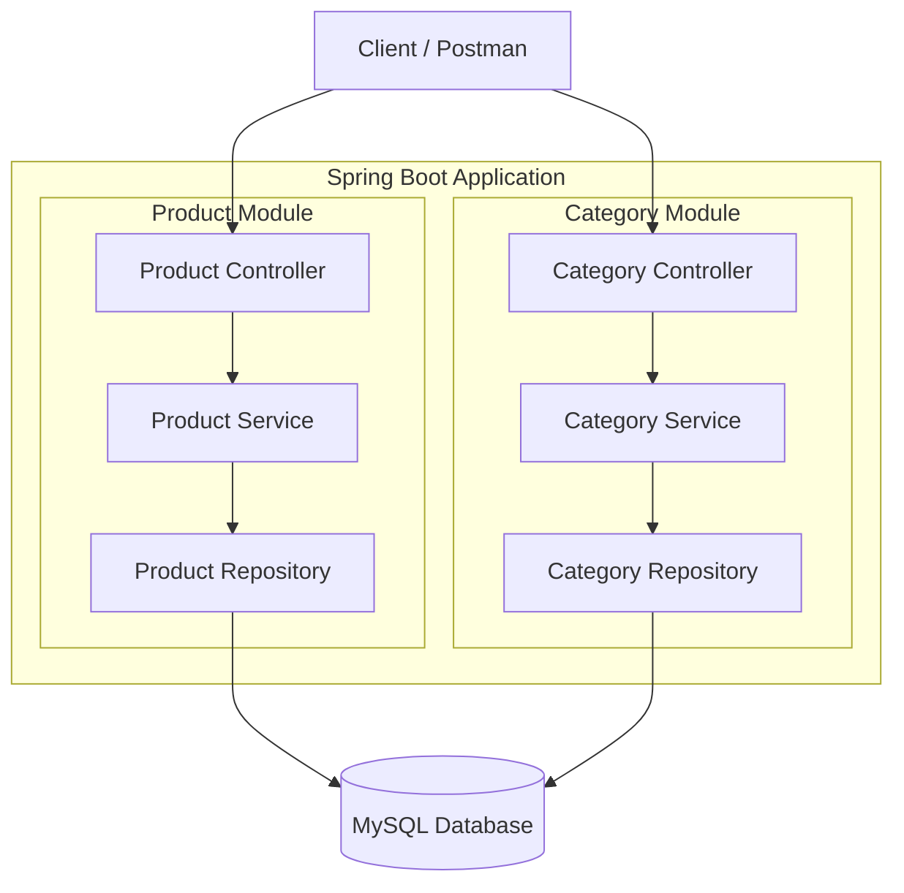
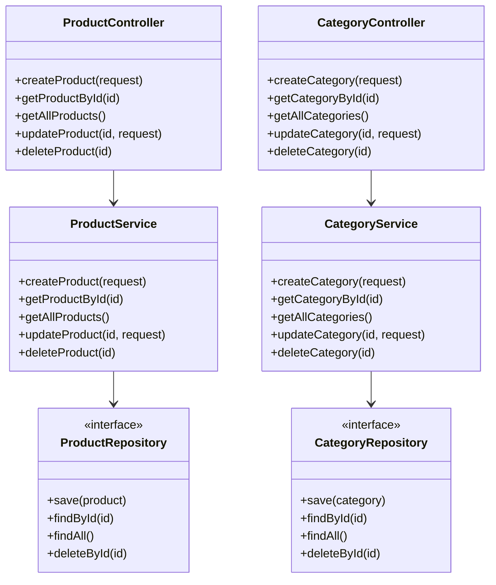
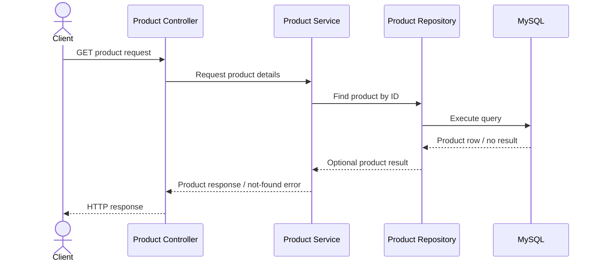
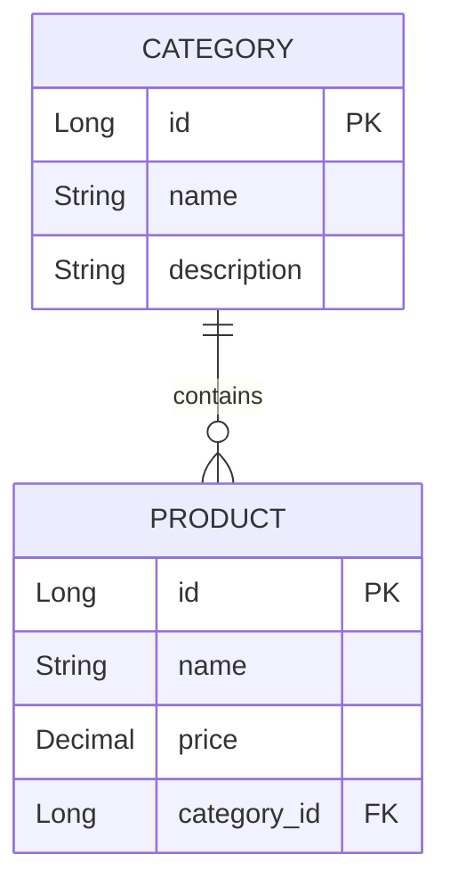

# Product and Category Management Application


A Spring Boot application organized into separate **Product** and **Category** modules. The project is intended to demonstrate a layered backend architecture with controllers, services, repositories, and database persistence.

> **Implementation note:** This README documents the intended architecture and common design. Confirm the actual Java version, Spring Boot version, entity fields, endpoint paths, table names, and relationship mappings against the source code before treating the illustrative examples below as exact implementation details.

---

## Table of Contents

- [Overview](#overview)
- [Features](#features)
- [Technology Stack](#technology-stack)
- [High-Level Design (HLD)](#high-level-design-hld)
- [Low-Level Design (LLD)](#low-level-design-lld)
- [Database Design](#database-design)
- [API Endpoints](#api-endpoints)
- [Project Structure](#project-structure)
- [Prerequisites](#prerequisites)
- [Configuration](#configuration)
- [Run the Application](#run-the-application)
- [Testing with Postman](#testing-with-postman)
- [Error Handling and Validation](#error-handling-and-validation)
- [Possible Improvements](#possible-improvements)
- [Interview Questions and Answers](#interview-questions-and-answers)
- [Author](#author)

---

## Overview

The application manages two related business concepts:

- **Products:** Product information and product operations.
- **Categories:** Category information and category operations.

The code is organized into separate modules so product-specific and category-specific responsibilities can be maintained independently. Both modules can use the same MySQL database while following the familiar Spring Boot layered pattern.

### Why this project?

This project is useful for practising and demonstrating:

- REST API design with Spring Boot.
- Separation of controller, service, and repository responsibilities.
- Database persistence with Spring Data JPA and MySQL.
- Product and category data modelling.
- API testing with Postman.
- Explaining backend architecture in Java interviews.

## Features

The following are common features for this type of application. Check the implementation before marking any item as completed.

- Product management: create, retrieve, update, and delete products.
- Category management: create, retrieve, update, and delete categories.
- Persistent storage using MySQL.
- Layered architecture.
- REST API testing using Postman.
- Potential product–category association, if implemented in the entity mappings.

## Technology Stack

| Technology | Purpose |
|---|---|
| Java | Backend programming language |
| Spring Boot | Application framework |
| Spring Web | HTTP and REST endpoints |
| Spring Data JPA | Repository and persistence abstraction, if configured |
| Hibernate | JPA implementation commonly used by Spring Data JPA |
| MySQL | Relational database |
| Maven | Dependency and build management |
| Postman | API testing |

**Version note:** Use the versions specified in the project's `pom.xml` and runtime configuration. The badges at the top are general indicators and should be updated to match the actual project.

---

## High-Level Design (HLD)

The architecture shows that the application manages both products and categories. Each module has its own controller, service, and repository layer. Both repositories access the shared MySQL database.

### Updated HLD Diagram

The following image is the supplied architecture diagram. Keep the image at `docs/images/updated-hld.png` when using this README in the repository.


### Editable Mermaid Version

The diagram below is an editable text version of the same high-level architecture. GitHub can render Mermaid diagrams directly in Markdown.



### HLD Component Responsibilities

| Component | Responsibility |
|---|---|
| Client / Postman | Sends HTTP requests and reads responses. |
| Product Controller | Receives product API requests and returns HTTP responses. |
| Product Service | Contains business rules for product operations. |
| Product Repository | Provides product persistence operations. |
| Category Controller | Receives category API requests and returns HTTP responses. |
| Category Service | Contains business rules for category operations. |
| Category Repository | Provides category persistence operations. |
| MySQL Database | Persists product and category data. |

### Typical Request Flow

1. The client sends an HTTP request to a controller.
2. The controller delegates the operation to the corresponding service.
3. The service applies business rules and validation as appropriate.
4. The service calls the relevant repository for persistence or retrieval.
5. The repository interacts with the database.
6. The result returns through the service and controller to the client.

For example, a product lookup request follows the Product Controller → Product Service → Product Repository path. A category request follows the equivalent Category path.

---

## Low-Level Design (LLD)

The layered design keeps responsibilities separate:

- **Controller layer:** Handles HTTP requests, path/query parameters, request bodies, and response status codes.
- **Service layer:** Implements business rules and coordinates repository calls.
- **Repository layer:** Reads and writes persistent data.
- **Entity layer:** Represents database-persisted domain objects when JPA entities are used.
- **DTO layer (optional):** Defines API request and response shapes separately from database entities.

### Illustrative Class Diagram

This is a conceptual diagram, not a verified inventory of the classes in the repository.



### Example Sequence: Retrieve a Product



---

## Database Design

The database stores product and category information. The exact schema depends on the entity classes and migrations in the repository.

### Illustrative Tables

The columns below are examples only. Replace them with the actual fields in the project's entities and database schema.

**Product**

| Column | Possible purpose |
|---|---|
| `id` | Unique product identifier and possible primary key |
| `name` | Product name |
| `description` | Product description, if supported |
| `price` | Product price, if supported |
| `category_id` | Possible foreign key to Category, if the relationship exists |

**Category**

| Column | Possible purpose |
|---|---|
| `id` | Unique category identifier and possible primary key |
| `name` | Category name |
| `description` | Category description, if supported |

### Product–Category Relationship (Conditional)

If one category can contain many products, the conceptual relationship is:



In this model:

- One category can be associated with multiple products.
- Each product references one category.
- `category_id` in the Product table references the Category table's primary key.
- A database foreign-key constraint can enforce referential integrity.

**Do not assume this relationship is implemented.** Verify the Product and Category entity classes and the actual schema first. If the relationship is implemented using JPA, it might use `@ManyToOne` on Product and optionally `@OneToMany` on Category. The exact annotations and ownership should match the code.

---


## API Endpoints

The table below is a **suggested REST API design**, not a verified list of endpoints. Replace paths, HTTP methods, and request examples with the mappings implemented in the controllers.

### Product APIs — Suggested

| Method | Example endpoint | Purpose |
|---|---|---|
| `POST` | `/api/products` | Create a product |
| `GET` | `/api/products` | Retrieve all products |
| `GET` | `/api/products/{id}` | Retrieve one product |
| `PUT` | `/api/products/{id}` | Update a product |
| `DELETE` | `/api/products/{id}` | Delete a product |

### Category APIs — Suggested

| Method | Example endpoint | Purpose |
|---|---|---|
| `POST` | `/api/categories` | Create a category |
| `GET` | `/api/categories` | Retrieve all categories |
| `GET` | `/api/categories/{id}` | Retrieve one category |
| `PUT` | `/api/categories/{id}` | Update a category |
| `DELETE` | `/api/categories/{id}` | Delete a category |

### Example Request Bodies

These examples apply only if the actual request DTOs or entities contain the shown fields.

**Possible product request**

```json
{
  "name": "Wireless Mouse",
  "description": "Wireless optical mouse",
  "price": 799.00,
  "categoryId": 1
}
```

**Possible category request**

```json
{
  "name": "Electronics",
  "description": "Electronic accessories and devices"
}
```

If the application does not use a `categoryId` field or these exact properties, adapt the examples to the actual request format.

---

## Project Structure

The user-provided structure indicates that Product and Category are separate modules under `src/main/java/com/flipkart`. A possible layered structure is shown below; confirm exact package and class names against the repository.

```text
src/
└── main/
    ├── java/
    │   └── com/
    │       └── flipkart/
    │           ├── product/
    │           │   ├── controller/
    │           │   ├── service/
    │           │   ├── repository/
    │           │   ├── entity/
    │           │   └── dto/
    │           ├── category/
    │           │   ├── controller/
    │           │   ├── service/
    │           │   ├── repository/
    │           │   ├── entity/
    │           │   └── dto/
    │           └── [application entry point]
    └── resources/
        └── application.properties
```

The directory names above are illustrative. Keep the real package layout and class names in the final repository README.

---

## Prerequisites

Install the tools required by the actual project:

- Java version compatible with the project's build configuration.
- Maven, or the project's Maven Wrapper (`mvnw` / `mvnw.cmd`).
- MySQL Server.
- Postman or another HTTP client.

## Configuration

Update `src/main/resources/application.properties` with the correct database connection settings.

Illustrative MySQL configuration:

```properties
spring.datasource.url=jdbc:mysql://localhost:3306/product_category_db
spring.datasource.username=${DB_USERNAME}
spring.datasource.password=${DB_PASSWORD}

# Use values compatible with the project's Spring Boot / Hibernate version.
# For local development only, if schema auto-update is appropriate:
spring.jpa.hibernate.ddl-auto=update

spring.jpa.show-sql=true
```

Before running the application:

1. Start MySQL.
2. Create the database if the application does not create it automatically.
3. Set `DB_USERNAME` and `DB_PASSWORD` in your environment, or use your local configuration method.
4. Confirm the MySQL JDBC driver is included in `pom.xml`.
5. Check that the database URL, port, and schema name match your environment.

**Security note:** Do not commit real database passwords, API keys, or other secrets to GitHub. Use environment variables or a secrets manager.

## Run the Application

From the project root, use the command supported by your environment:

```bash
# With Maven installed
mvn spring-boot:run
```

Or, on Windows, if the project includes the Maven Wrapper:

```bat
mvnw.cmd spring-boot:run
```

On macOS/Linux:

```bash
./mvnw spring-boot:run
```

If the application starts successfully, check the startup logs for the active port and any database connection errors. Do not assume the port is `8080` if the project configuration overrides it.

## Testing with Postman

1. Start the application and confirm it connects to MySQL.
2. Create or retrieve a category using the actual category endpoint.
3. Test product creation and retrieval using the actual product endpoint.
4. If products reference categories, test valid and invalid category IDs.
5. Test update and delete operations.
6. Check response status codes and database records.
7. Test invalid input and missing-resource scenarios.

Use the actual controller mappings and request fields when configuring Postman.

## Error Handling and Validation

For a production-ready API, consider handling the following cases:

- Request body fails validation.
- Requested product or category does not exist.
- A referenced category does not exist, if product–category association is implemented.
- A duplicate category name violates a business rule, if uniqueness is required.
- Database connection or persistence operations fail.

A common Spring approach is to use Jakarta Bean Validation annotations such as `@NotBlank`, `@Positive`, and `@Valid`, together with centralized exception handling using `@RestControllerAdvice`. Add these only if they are present or planned in the project.

## Possible Improvements

These are possible future enhancements, not claims about existing functionality:

- Request and response DTOs.
- Input validation and centralized exception responses.
- Pagination, sorting, and filtering.
- Search by product name or category.
- Database migrations with Flyway or Liquibase.
- Unit tests for services and integration tests for controllers.
- OpenAPI / Swagger API documentation.
- Authentication and role-based authorization.
- Docker-based local development.
- Logging, monitoring, and health checks.

---

## Interview Questions and Answers

### 1. Why do we use a layered architecture?

It separates HTTP handling, business logic, and persistence. This makes code easier to test, maintain, and change.

### 2. What is the responsibility of a controller?

A controller maps HTTP requests to application operations, delegates work to the service layer, and returns an appropriate HTTP response.

### 3. Why should business logic be in the service layer?

The service layer keeps business rules out of controllers and can coordinate multiple repository operations in one use case.

### 4. What is the role of a repository?

A repository abstracts data access. With Spring Data JPA, repository interfaces can provide common CRUD operations without requiring each operation to be implemented manually.

### 5. Why use MySQL?

MySQL is a relational database that stores structured data and supports SQL queries, constraints, and relationships.

### 6. What is ORM?

Object-Relational Mapping maps application objects to relational database tables. Hibernate is a common ORM implementation used with JPA.

### 7. What is the difference between `@Controller` and `@RestController`?

`@Controller` is commonly used for MVC controllers that return views. `@RestController` combines `@Controller` and `@ResponseBody`, so methods typically return response data directly.

### 8. What is the difference between `CrudRepository` and `JpaRepository`?

Both provide repository operations. `JpaRepository` adds JPA-specific functionality and commonly includes paging and sorting capabilities through its repository hierarchy.

### 9. How would you model a category containing multiple products?

If that business rule applies, a common relational model is a one-to-many relationship: a product holds a foreign key to its category. In JPA, Product may own a `@ManyToOne` mapping, with an optional inverse `@OneToMany` collection in Category.

### 10. How do you handle a product that references a nonexistent category?

If the association exists, validate the category identifier in the service layer and return a suitable client error when it does not exist. A database foreign-key constraint can provide additional integrity protection.

### 11. Why use DTOs?

DTOs separate the public API contract from persistence entities, allowing validation and response formats to evolve without exposing internal entity details.

### 12. How would you test this application?

Use unit tests for business logic, controller tests for HTTP behaviour, and integration tests for database persistence and entity relationships.

### 13. What is dependency injection in Spring?

Dependency injection lets Spring provide the objects a class needs instead of the class creating those dependencies itself. Constructor injection is generally a clear and testable choice.

### 14. What is the purpose of a database foreign key?

A foreign key enforces a relationship between tables and helps prevent references to nonexistent parent records.

### 15. How would you improve this application for production?

I would add validation, centralized error handling, automated tests, API documentation, secure configuration, observability, and appropriate pagination and database indexes based on usage.

---

## Author

**Alok Kumar Saw**

- GitHub: [ALOKKUMARSAW](https://github.com/ALOKKUMARSAW)
- LinkedIn: [Alok Kumar Saw](https://www.linkedin.com/in/alok-kumar-saw/)

---

If you use this README in the repository, commit the image alongside it at `docs/images/updated-hld.png` so the HLD image renders correctly on GitHub.
